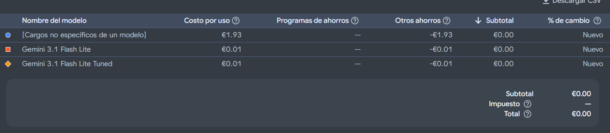

# Sesión 8 · Fine-Tuning de Modelos Cerrados (Gemini 3.1 Flash-Lite y Claude Haiku 4.5)

En este proyecto se realiza un entrenamiento personalizado (*Supervised Fine-Tuning*) del modelo cerrado **Gemini 3.1 Flash-Lite** en Google Cloud Vertex AI. Posteriormente, se compara su rendimiento frente a su versión original sin entrenar (**Gemini Base**) y frente a **Claude Haiku 4.5** utilizando ejemplos en las instrucciones (*Few-Shot*).

Para completar la comparativa de seis escenarios, la tabla final integra los resultados obtenidos previamente en la **Sesión 7** con el modelo abierto **Qwen3-0.6B**. No ha sido necesario volver a ejecutar dicho modelo, ya que se han mantenido exactamente los mismos datos y reglas de validación.

---

##  Estructura del Proyecto

* **`conversor.py`**: Transforma los conjuntos de entrenamiento (150 casos) y validación (30 casos) al formato JSONL requerido por Google Cloud y los sube a Google Cloud Storage.
* **`entrenar_gemini.py`**: Lanza el proceso de entrenamiento en la región `europe-west4` sobre `gemini-3.1-flash-lite` y supervisa su finalización.
* **`comparar_modelos.py`**: Evalúa Gemini Base, Gemini Ajustado y Claude Haiku 4.5 sobre los 30 casos de prueba (test), registrando el tiempo de respuesta, los tokens consumidos y el porcentaje de acierto.
* **`datos/`**: Archivos originales reutilizados de la Sesión 7 (`entrenamiento_ejemplos.json`, `validacion_ejemplos.json`, `test_ejemplos.json`).
* **`datos_gemini/`**: Archivos adaptados al formato de Google (`train_gemini.jsonl`, `val_gemini.jsonl`) junto con el archivo `relacion_identificadores.json`, que permite vincular cada ejemplo con su identificador original.
* **`evidencia_tuning_gemini.json`**: Registro que confirma la correcta finalización del entrenamiento y guarda el identificador del modelo resultante.
* **`resultados_originales_sesion8.json`**: Respuestas originales generadas por los tres modelos evaluados sobre el conjunto de prueba, guardadas sin alteraciones.
* **`.env.example` / `.gitignore`**: Archivos de configuración para proteger las variables del entorno y evitar la exposición de credenciales.

---

##  Configuración y Reglas de Evaluación

* **Entrenamiento en Google Cloud:** El ajuste de `gemini-3.1-flash-lite` se ejecutó en `europe-west4` y finalizó correctamente (`JOB_STATE_SUCCEEDED`).
* **Parámetros de inferencia:** Todas las pruebas de Gemini se realizaron en el endpoint europeo (`eu`) con `thinking_level="MINIMAL"`, temperatura `0.0` (para obtener respuestas deterministas) y un límite de `150` tokens de salida.
* **Protocolo de validación:** Se solicitó el JSON como texto plano, sin utilizar modos que fuercen el formato ni programas que corrijan errores posteriormente. Asimismo, los 30 casos de test no se incluyeron en el entrenamiento ni en los 4 ejemplos facilitados a Claude Haiku 4.5.

---

## Tabla Comparativa de 6 Condiciones (Sobre 30 casos de Test)

*Nota: Las condiciones 1 a 3 corresponden a los resultados registrados en la Sesión 7 (ejecutados en Google Colab con GPU T4). Las condiciones 4 a 6 corresponden a las pruebas realizadas en esta sesión. La API del laboratorio de Google Cloud no informa del importe económico en dólares del entrenamiento ni de las predicciones de Gemini.*

| Condición Evaluada | JSON Válido | Acierto Categoría | Acierto Prioridad | Latencia Media | Tokens (Entrada / Salida) | Coste Predicción |
| :--- | :---: | :---: | :---: | :---: | :---: | :---: |
| **1. Qwen3-0.6B Base (Zero-Shot)** *(Sesión 7)* | 80.0 % | 20.0 % | 40.0 % | — | Local / Colab T4 | $0 *(GPU gratuita)* |
| **2. Qwen3-0.6B Base (Few-Shot)** *(Sesión 7)* | 100.0 % | 80.0 % | 30.0 % | — | Local / Colab T4 | $0 *(GPU gratuita)* |
| **3. Qwen3-0.6B Ajustado (LoRA)** *(Sesión 7)* | 100.0 % | 56.7 % | 50.0 % | — | Local / Colab T4 | $0 *(GPU gratuita)* |
| **4. Gemini 3.1 Flash-Lite Base** | **100.0 %** | 96.7 % | 70.0 % | **0.75 s** | 2.782 / 1.868 | No reportado por API |
| **5. Gemini 3.1 Flash-Lite Ajustado** | **100.0 %** | **100.0 %** | **83.3 %** | 1.40 s | **2.782 / 1.018** | No reportado por API |
| **6. Claude Haiku 4.5 (Few-Shot)** | 96.7 % | 93.3 % | 66.7 % | 1.44 s | 11.347 / 1.558 | **$0.019137** *(OpenRouter)* |

---

## Interpretación de Resultados

### 1. Calidad y Precisión
* **Efecto del entrenamiento en Gemini:** Tras el ajuste fino, **Gemini 3.1 Flash-Lite Ajustado** alcanza un **100.0 % de acierto en categoría** y mejora la precisión en **prioridad del 70.0 % al 83.3 %**. Además, mantiene un **100.0 % de respuestas en JSON válido** y reduce casi a la mitad los tokens de salida (de 1.868 a 1.018), generando respuestas más directas.
* **Rendimiento de Claude Haiku 4.5 (Few-Shot):** Consigue una buena precisión en categoría (93.3 %) sin entrenamiento previo, pero pierde acierto en prioridad (66.7 %) y comete un fallo de formato JSON (96.7 %). Al necesitar ejemplos en cada consulta, consume **4 veces más tokens de entrada** (11.347 frente a 2.782).
* **Modelos cerrados frente a modelos abiertos:** Los modelos cerrados evaluados superan al modelo compacto **Qwen3-0.6B** en la clasificación de prioridad (83.3 % frente a 50.0 %), aunque Qwen3 ajustado iguala el 100.0 % de fiabilidad en la estructura del JSON.

### 2. Costes e Infraestructura Utilizada
* **Google Cloud Vertex AI (Gemini):** Aunque la API no devuelve el importe económico en el momento de la llamada, el panel de **Facturación (Billing)** de Google Cloud refleja el desglose exacto pasadas 24 horas:
  * **Coste de entrenamiento (fijo inicial):** **€1.93** (registrado bajo *Cargos no específicos de un modelo*, correspondiente al trabajo de *fine-tuning*).
  * **Coste de predicción (inferencia):** **€0.01** para las 30 consultas de **Gemini Base** y **€0.01** para las 30 consultas de **Gemini Ajustado** (la consola redondea importes pequeños a dos decimales, aunque las tarifas reales por millón de tokens difieren entre ambos modelos).
  * **Coste neto final:** **€0.00**, ya que el gasto de **€1.95** quedó cubierto por los créditos promocionales del laboratorio.

* **OpenRouter (Claude Haiku 4.5):** No requiere inversión inicial de entrenamiento. La API reportó un coste directo de **$0.019137** por las 30 predicciones realizadas.
* **Google Colab (Qwen3-0.6B):** Coste directo de **$0**, al haberse ejecutado en Google Colab.

### 3. Criterio de Elección
* **Para entornos de producción que exigen máxima precisión:** Se recomienda **Gemini 3.1 Flash-Lite Ajustado**, ya que ofrece los mejores porcentajes de acierto (100 % en categoría y 83.3 % en prioridad), garantiza el formato JSON y optimiza el consumo de tokens por respuesta.
* **Para una puesta en marcha rápida sin fase de entrenamiento:** Se recomienda **Gemini 3.1 Flash-Lite Base**, por ofrecer el menor tiempo de respuesta (**0.75 segundos**) y una alta fiabilidad en categoría (96.7 %) sin coste inicial.
* **Para proyectos con requisitos estrictos de privacidad y control:** Se recomienda **Qwen3-0.6B Ajustado**, ya que permite conservar el modelo en infraestructura propia y procesar los datos de forma local sin depender de proveedores externos.
